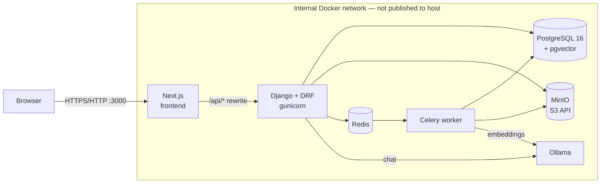
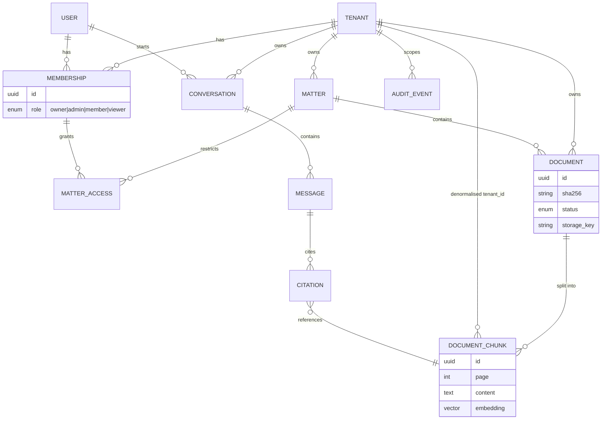
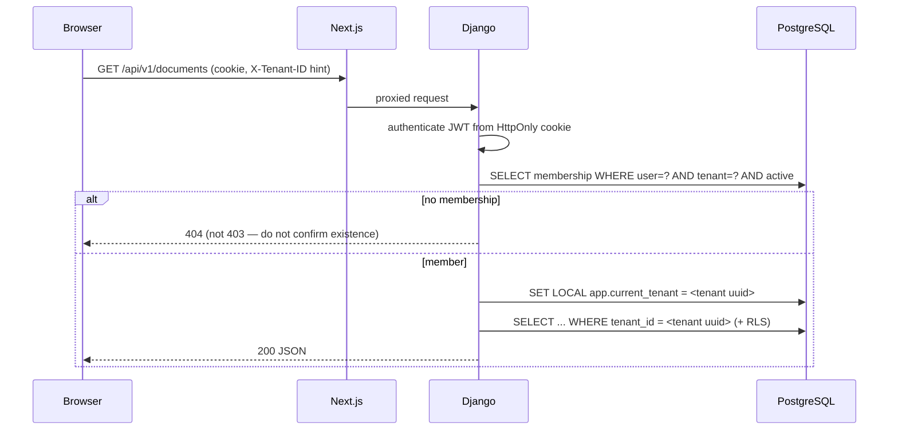
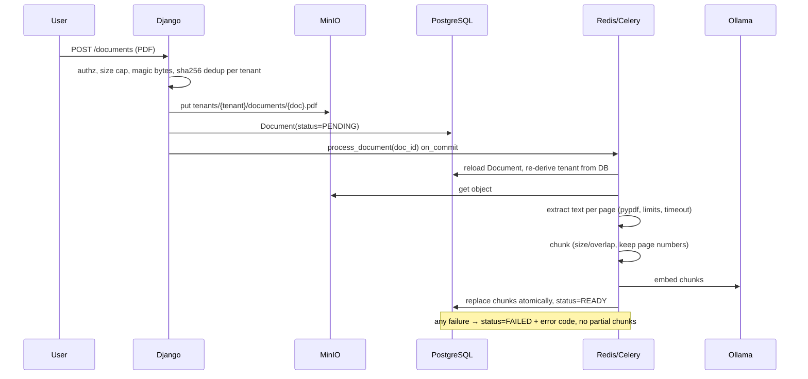

# cIAtadel — Architecture Overview

> Status: Phase 1 (architecture + scaffolding). POC with fictional data only —
> no compliance or certification is claimed.

## 1. Guiding principles

1. **Tenant isolation first.** Every tenant-owned row carries a non-nullable
   `tenant` FK; every query goes through a tenant-scoped manager; PostgreSQL
   Row-Level Security is a second, independent line of defence.
2. **Modular monolith.** One Django project, nine bounded apps, one Celery
   worker image. No microservices until a real scaling need appears.
3. **Single front door.** The browser only talks to Next.js. Next.js proxies
   `/api/*` to Django on the internal network. PostgreSQL, MinIO, Redis and
   Ollama are never reachable from the browser (and mostly not from the host).
4. **Providers behind interfaces.** Storage (S3 API), LLM and embeddings
   (provider registry) and identity (`external_subject` on `User`) are
   configured, not hard-coded — so the AWS move swaps adapters, not business
   logic.
5. **Documents are untrusted input.** Parsed in a worker with time/size limits,
   never executed, and treated as *data* inside LLM prompts.

## 2. Local runtime (Docker Compose — Phase 2)



Only the frontend port is published by default. MinIO console / Postgres can be
exposed through an opt-in `docker-compose.override.yml` for debugging.

## 3. Backend modules

| App             | Responsibility                                                                  | Key models (planned)                       |
|-----------------|----------------------------------------------------------------------------------|--------------------------------------------|
| `core`          | Request IDs, health, error envelope, `TenantOwnedModel`, tenant-scoped querysets | abstract bases only                        |
| `tenants`       | Firms, tenant resolution (`request.tenant`), RLS context                         | `Tenant`                                   |
| `accounts`      | Users, memberships, roles, cookie-JWT auth, OIDC-ready identity                  | `User`, `Membership`, `Invitation`         |
| `matters`       | Matters / folders; optional per-matter access restriction                        | `Matter`, `MatterAccess`                   |
| `documents`     | Upload validation, storage keys, lifecycle, dedup, deletion                      | `Document`                                 |
| `rag`           | Extraction, chunking, embeddings, **tenant-filtered** vector search              | `DocumentChunk` (pgvector)                 |
| `ai_engine`     | `LLMProvider` / `EmbeddingProvider` interfaces; Ollama + Fake adapters; prompts  | none                                       |
| `conversations` | Chat sessions, messages, citations, streaming                                    | `Conversation`, `Message`, `Citation`      |
| `audit`         | Append-only security & activity log                                              | `AuditEvent`                               |

Dependency direction (no cycles): `core ← tenants ← accounts ← matters ←
documents ← rag ← conversations`, with `ai_engine` used by `rag` and
`conversations`, and `audit` usable by everyone.

### Planned data model



`DocumentChunk` deliberately duplicates `tenant_id` and `matter_id` so the
vector search can filter on them in the same SQL statement as the similarity
ordering (no post-filtering of results that already crossed a boundary).

## 4. Key flows

### 4.1 Authenticated, tenant-scoped API request



### 4.2 Document ingestion (Phases 5–6)



### 4.3 RAG question (Phases 7–8)

1. Authenticate; resolve tenant from membership; check matter access.
2. Embed the question.
3. `SELECT ... FROM rag_documentchunk WHERE tenant_id = :t AND matter_id = ANY(:allowed) AND document.status='READY' ORDER BY embedding <=> :q LIMIT :k` — the filter and the ranking happen **in the same query**.
4. Build the prompt: system rules → retrieved passages wrapped in delimited,
   labelled `<document>` blocks marked as untrusted → user question.
5. Call the LLM (streamed when possible); require answers to cite `[n]`
   markers; respond "not found in the provided documents" when context is
   insufficient.
6. Persist `Message` + `Citation` rows (doc, page, chunk) under the same tenant.

## 5. Frontend

Next.js App Router + TypeScript + Tailwind + shadcn/ui + TanStack Query.

- Same-origin only; tokens live in HttpOnly cookies, CSRF double-submit for
  mutations (`src/lib/api.ts`).
- Route groups (Phase 4): `(auth)/login`, `(app)/[tenant]/dashboard`,
  `documents`, `assistant`, `admin`, `audit`. Middleware redirects
  unauthenticated users; **the server remains the only authority** — hidden UI
  is never treated as access control.

## 6. AWS target mapping (Phase 10, not deployed)

See `../../mermaid-diagram.png` for the target landing zone.

| Local          | AWS                                    | Abstraction that makes the swap cheap              |
|----------------|----------------------------------------|----------------------------------------------------|
| MinIO          | S3 (SSE-KMS, Block Public Access)      | boto3 S3 client; `S3_ENDPOINT_URL` empty on AWS    |
| PostgreSQL     | RDS PostgreSQL + pgvector              | `DATABASE_URL`                                     |
| Redis          | ElastiCache (TLS)                      | `REDIS_URL`                                        |
| Containers     | ECS Fargate behind ALB                 | same images; config via env/Secrets Manager        |
| Ollama         | Bedrock or EC2 GPU (vLLM)              | `ai_engine` provider registry                      |
| `.env`         | Secrets Manager / SSM                  | env injection by ECS task definition               |
| —              | KMS                                    | S3/RDS encryption, later per-tenant keys           |
| stdout logs    | CloudWatch Logs                        | structured logs with request IDs                   |
| Django auth    | Cognito / OIDC (Keycloak)              | `User.external_subject`, pluggable authenticator   |

## 7. Repository layout

```
.
├── backend/                 Django modular monolith
│   ├── config/              settings (base/dev/test/prod), urls, celery, wsgi/asgi
│   ├── apps/                core, tenants, accounts, matters, documents,
│   │                        rag, ai_engine, conversations, audit
│   └── tests/               cross-app security + integration suites (Phase 9)
├── frontend/                Next.js App Router
├── docs/
│   ├── brief.md             product brief
│   ├── architecture/        this overview + security design
│   ├── adr/                 architecture decision records
│   └── roadmap.md           phase tracker
├── infra/terraform/         (Phase 10) module skeleton
├── docker-compose.yml       (Phase 2)
├── .env.example
└── .github/workflows/ci.yml
```
